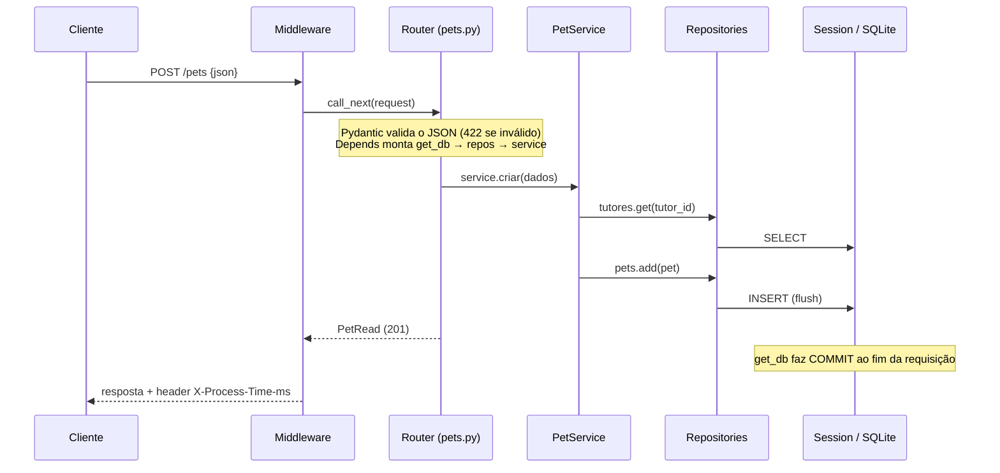

# GestãoPet API · FastAPI

Prova de Conceito (PoC) do **Seminário Técnico de Frameworks Modernos e Design Patterns**
(Análise e Projeto de Sistemas de Informação · IFAL Maceió).

Equipe: Marlos, Nicolas, Vitor e Yury.

API REST com CRUD de **tutores** e **pets**, organizada em camadas para evidenciar os
padrões de projeto que o FastAPI aplica ou incentiva.

## Como rodar

```bash
python -m venv .venv
# Windows
.venv\Scripts\activate
# Linux/macOS
source .venv/bin/activate

pip install -r requirements.txt
fastapi dev app/main.py
```

Acesse a documentação interativa (gerada automaticamente) em **http://127.0.0.1:8000/docs**.

Testes automatizados:

```bash
pytest -v
```

## Endpoints

| Método | Rota | Descrição |
|---|---|---|
| POST | `/tutores` | Cadastra tutor (e-mail único) |
| GET | `/tutores` | Lista tutores com seus pets |
| GET | `/tutores/{id}` | Busca tutor |
| PATCH | `/tutores/{id}` | Atualiza campos do tutor |
| DELETE | `/tutores/{id}` | Exclui tutor e seus pets |
| GET | `/tutores/{id}/pets` | Pets de um tutor |
| POST | `/pets` | Cadastra pet (tutor deve existir) |
| GET | `/pets?especie=gato` | Lista pets, com filtro opcional |
| GET | `/pets/{id}` | Busca pet |
| PATCH | `/pets/{id}` | Atualiza pet |
| DELETE | `/pets/{id}` | Exclui pet |

## Estrutura de pastas

```
app/
├── main.py              # monta o app: middleware, handlers de erro, routers
├── dependencies.py      # "fiação" da Injeção de Dependência
├── core/
│   ├── config.py        # configurações (Singleton)
│   └── exceptions.py    # exceções de domínio
├── db/session.py        # engine e Session (Unit of Work)
├── models/entities.py   # tabelas ORM (Data Mapper)
├── schemas/dtos.py      # entrada/saída da API (DTO, Pydantic)
├── repositories/        # acesso a dados (Repository)
├── services/            # regras de negócio
└── routers/             # endpoints HTTP (Decorator)
tests/test_api.py        # testes com troca de dependência
```

## Fluxo de uma requisição



## Design Patterns na PoC

| Padrão | Onde | Como aparece |
|---|---|---|
| **Injeção de Dependência / IoC** | [app/dependencies.py](app/dependencies.py), routers | `Depends(...)` e `Annotated`; o framework monta `get_db → Repository → Service`. Nos testes, `dependency_overrides` troca o banco sem mudar a aplicação. |
| **Decorator** | [app/routers/](app/routers/) | `@router.get`, `@router.post` e `@app.middleware` adicionam roteamento, validação e documentação a funções comuns. |
| **Repository** | [app/repositories/](app/repositories/) | `BaseRepository[ModelT]` genérico isola o acesso a dados dos serviços. |
| **Data Mapper** | [app/models/entities.py](app/models/entities.py) | Modelos SQLAlchemy sem `save()`; a Session mapeia objeto ↔ tabela. |
| **Unit of Work** | [app/db/session.py](app/db/session.py) | Uma Session por requisição: `commit` em sucesso, `rollback` em erro. |
| **DTO** | [app/schemas/dtos.py](app/schemas/dtos.py) | Schemas Pydantic separados dos modelos: `TutorCreate`, `TutorUpdate`, `TutorRead`. |
| **Singleton** | [app/core/config.py](app/core/config.py) | `@lru_cache` em `get_settings()` garante uma única instância. |
| **Chain of Responsibility** | [app/main.py](app/main.py) | Middleware recebe a requisição e repassa ao próximo elo com `call_next`. |
